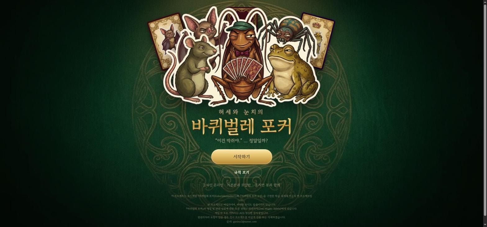
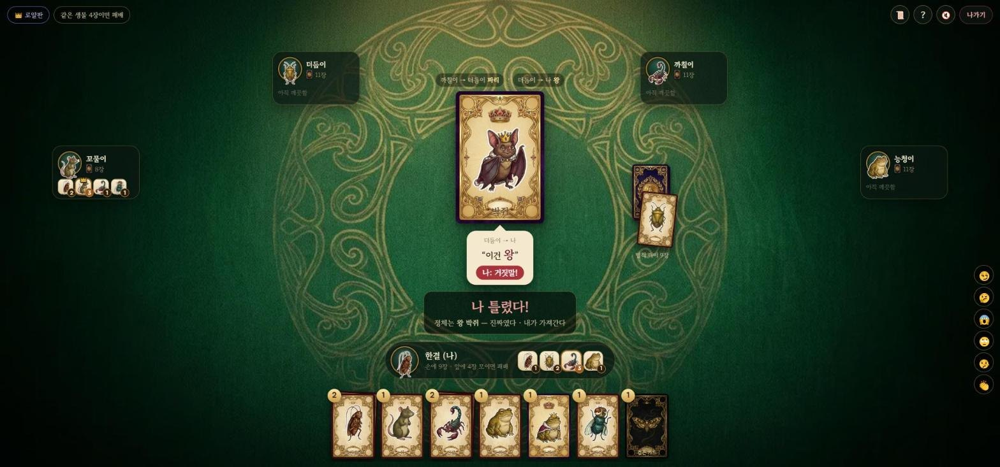

# 🪳 바퀴벌레 포커

  [](https://cockroach.41ways.workers.dev/) [](https://41ways.github.io/norara/)

카드를 엎어서 내밀며 **“이건 박쥐야”** 라고 말하는 허세와 눈치의 온라인 카드 게임.
**기본판**과 **로얄판**(왕 · 신하 · 검은 카드)을 방장이 골라서 한다. 자리는 **2~6인**, 모자라면 봇으로 채운다.





## 한눈에

| | |
|---|---|
| **종류** | 보드게임 · 온라인 |
| **인원** | 2~6인 (봇으로 채우면 혼자도) |
| **플레이** | **https://cockroach.41ways.workers.dev/** |
| **로컬 실행** | `npm install && npm start` → http://localhost:8795 |
| **한 줄 규칙** | 같은 생물 4장이 내 앞에 쌓이면 진다 |
| **허브** | https://41ways.github.io/norara/ |

## 규칙

### 기본판 — 생물 8종 × 8장 = 64장

바퀴벌레 · 쥐 · 노린재 · 전갈 · 두꺼비 · 박쥐 · 파리 · 거미. 모두 나눠 준다.

1. 차례인 사람이 손에서 카드 한 장을 엎어 다른 사람에게 내밀며 **“이건 두꺼비야”** 또는 **“이건 두꺼비가 아니야”** 라고 말한다. 진짜든 거짓말이든 상관없다. (아니라는 말은 이 판의 덧붙인 규칙 — 검은 카드는 이 말에도 틀린다)
2. 받은 사람은 둘 중 하나.
   - **진짜다 / 거짓말!** — 외치고 뒤집는다. 맞히면 내민 사람이, 틀리면 받은 사람이 그 카드를 앞에 펼친다.
   - **몰래 보고 넘기기** — 혼자 보고, 아직 이 카드를 안 본 사람에게 다시 내민다(말은 바꿔도 된다). 모두 본 카드면 마지막 사람은 반드시 외친다.
3. 카드를 앞에 펼친 사람이 다음 카드를 내민다.
4. **같은 생물 4장**이 앞에 쌓이거나, 내밀 차례인데 **손이 비면** 진다. 나머지는 모두 이긴다.
5. **2인**: 카드 10장을 아무도 보지 않고 빼 두고 나눈다. 넘기기 없음, 같은 생물 **5장**이면 패배.

### 로얄판 — 생물 7종 × 8장 + 왕 7장 + 특수 2장 = 65장

거미가 빠지고 세 가지가 더해진다.

| 카드 | 하는 일 |
|---|---|
| **왕 카드** (종마다 1장) | 그 생물이라고 해도, **“왕”** 이라고 해도 맞다. 앞에 펼치면 **벌칙 더미**의 펼쳐진 윗장도 가져와 펼친다(또 왕이면 한 장 더). 개수는 그 생물로 센다 |
| **신하** | 아무 생물이라고 해도 맞다. **“왕”** 이라고 하면 틀린다 |
| **검은 카드** | 무엇이라고 해도 틀린다 |

- 말할 수 있는 것: 생물 7종 + “왕”
- 시작할 때 벌칙 더미 7장을 엎어 두고 윗장을 펼친다. 나머지를 똑같이 나누고, 남는 장은 첫 사람이 한 장 더 갖고 나머지는 벌칙 더미로 간다.
- **특수 카드를 떠안으면** 앞에 두지 않고 손으로 가져간다. 대신 마지막에 들은 말과 맞는 카드 1장을, 없거나 싫으면 아무 카드 2장을 손에서 앞에 펼친다.
- **2인 로얄**: 벌칙 더미 16장, 넘기기 없음, 같은 생물 **5장**이면 패배.

> 로얄판 상자에는 66장이라고 적힌 판본도 있지만, 실제로 쓰는 카드는 생물 56 + 왕 7 + 특수 2 = 65장이다.

## 화면

1. **타이틀** — `시작하기` 와 `규칙 보기`
2. **테이블 고르기** — 이름을 넣고 새 테이블을 열거나, 4글자 코드 · 열린 테이블 목록으로 들어간다(기본/로얄 표시)
3. **대기실** — 판 종류(기본판 · 로얄판), 생각할 시간, 비공개 · 관전, 봇 부르기. 내 얼굴(생물)을 바꿀 수 있다
4. **게임** — 상대 자리는 테이블 위쪽 호, 가운데는 오가는 카드와 말풍선, 아래는 내 자리와 손패(같은 카드끼리 더미). 할 일이 있을 때만 할 일 판이 뜬다
5. **결과** — 진 사람과 모두의 앞줄

채팅 · 표정(😏🤔😱🙄🤥👏) · 지난 판정 기록 · 관전 · 새로고침해도 자리 유지 · 효과음(🔊/🔇)이 있다.

## 그림

모든 그림은 제미나이로 만들었다(`raw/` 원본 → `tools/` 로 가공).

| 단계 | 도구 |
|---|---|
| 마젠타 바탕 시트에서 낱장 잘라 내기 | `python tools/cut_sheet.py raw/creatures.png public/img/c_ --names roach,rat,… --size 512` |
| 오른쪽 아래 반짝이 표시 걷기 | `python tools/dewatermark.py raw/back.png …` |
| 카드 앞면 합성 · webp 로 굽기 | `python tools/build_assets.py` |
| 한글 글꼴 줄이기(KS X 1001 2350자) | `python tools/make_fonts.py` |

`raw/` 는 원본이 커서 저장소에 올리지 않는다. 글꼴은 Google Fonts 의 고운바탕 · 주아(OFL).

## 구조

```
rules.js       덱 · 나누기 · 맞는지 · 판정 (순수 함수, 서버와 테스트가 같이 씀)
game.js        방 · 손패 · 오가는 카드 · 벌칙 더미 · 타이머 · 봇. 서버가 판을 전부 쥔다 (로보77 과 같은 짜임)
worker.js      Cloudflare Workers 서버 — 소켓을 Durable Object 하나로 받아 game.js 에 넘긴다 (실제 서비스)
server.js      Node 서버 — 같은 game.js 를 ws 로 띄운다 (로컬 개발 · 테스트)
docs/          HANDOFF.md(인계) · OVERNIGHT.md(밤샘 기록)
public/        화면 (index.html · style.css · app.js · img · fonts)
test/rules.js  규칙 · 예외 상황 21가지 — 판정표, 2인 규칙, 왕 벌칙 연쇄, 특수 카드 값, 끊김 · 나가기 · 재접속, 관전, 권한
test/sim.js    서버 없이 판을 수십 번 끝까지 — 카드 수 보존, 카드 정체가 안 본 사람·관전자에게 새지 않는지
test/soak.js   방 수십 개를 동시에 — 수천 판, 끝나지 않는 판 · 정보 누출 · 봇이 무작위보다 나은지
test/e2e.js    떠 있는 서버에 웹소켓 둘로 — 방 목록 · 입장 · 채팅 · 판 끝까지
test/prod.js   배포본에서 실제 속도로 한 판 끝까지
```

오가는 카드의 정체는 **그 카드를 본 사람(내민 사람 · 몰래 본 사람)에게만** 내려간다. 개발자 도구로도 볼 수 없다.

## 테스트

```bash
npm test                                   # rules.js · sim.js · soak.js(400판)
GAMES=3000 PAR=60 node test/soak.js        # 대량 시뮬레이션
node test/prod.js royal 4                  # 배포본에서 한 판
ROACH_FAST=1 PORT=8799 node server.js      # 한 창에서
PORT=8799 node test/e2e.js                 # 다른 창에서
```

## 배포 (Cloudflare Workers 무료 플랜)

```bash
npx wrangler login     # 처음 한 번
npx wrangler deploy
```

- 그림 · 글꼴 · 화면은 **정적 자산**이라 요청 수 한도에 잡히지 않는다. 소켓(`/ws`)만 Durable Object 하나로 간다.
- 결제 수단을 등록하지 않으면 한도를 넘어도 요금이 붙지 않고 그날 요청만 거절된다.
- 켜진 시간을 아끼려고 20분 동안 조작이 없는 연결은 닫는다(누르면 다시 붙는다). 방도 소켓도 없으면 청소 타이머까지 멈춰서 객체가 잠든다.

## 저작권

이 프로젝트는 보드게임 『바퀴벌레 포커(Kakerlakenpoker)』와 『바퀴벌레 포커 로얄』을 구현한 학습 목적의 비공식 팬 프로젝트입니다.
본 프로젝트는 비영리이며, 어떠한 수익도 발생시키지 않습니다.
『바퀴벌레 포커』의 명칭 및 관련 상표에 대한 모든 권리는 원권리자(Drei Magier Spiele)에게 있습니다.
게임 내 모든 이미지는 AI로 생성한 창작물입니다.
원권리자의 요청이 있을 경우 즉시 프로젝트를 비공개 전환 또는 삭제하겠습니다.
문의: gyolno2@naver.com
